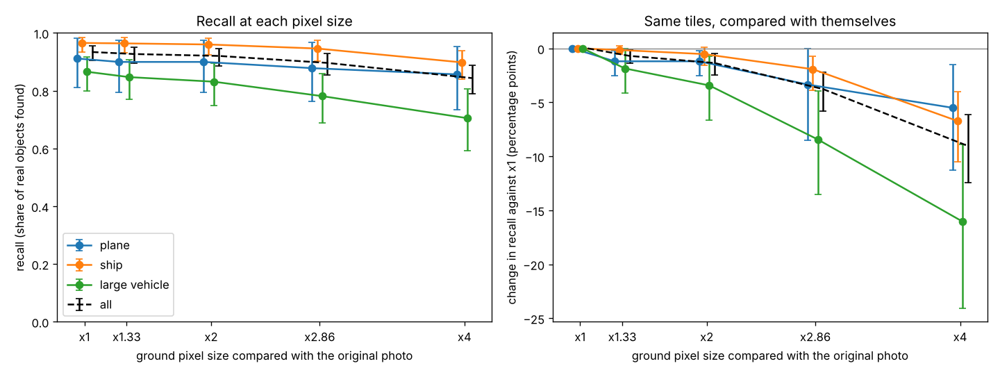
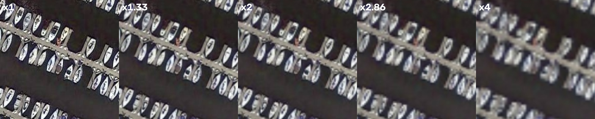
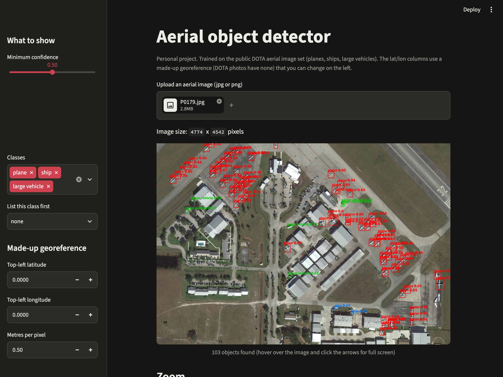
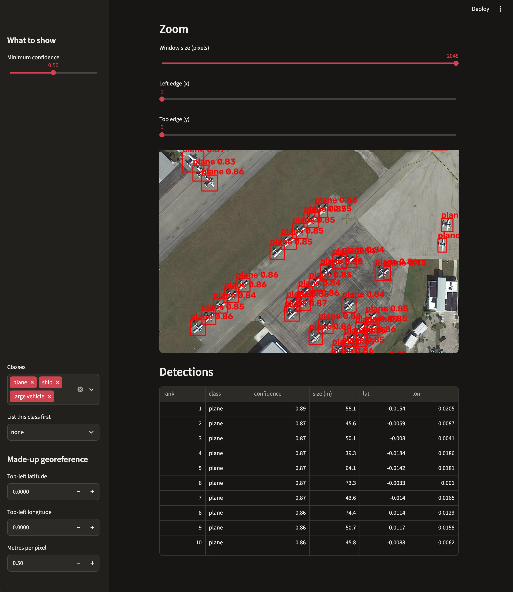

# Aerial object detection: planes, ships and large vehicles

Personal project. I trained a small YOLO model to find planes, ships and large vehicles in aerial photos, then built a web page where you upload a photo, change what is shown, and see the detections, with a made-up lat/lon for each one, and zoom into any part of the photo.

## Data

DOTA v1.0, a public set of aerial photos with hand-drawn boxes (Wuhan University). I use 3 of its 15 classes: plane, ship, large vehicle. I did not label anything myself. The copy I download is the one hosted by Ultralytics: 1,411 training photos and 458 validation photos. DOTA is released for academic use, see its page for the terms.

## How it works

The photos are up to 4,000 pixels wide, so step 3 cuts them into 640 x 640 tiles with some overlap and rewrites the labels to match. The model is YOLO11n (the smallest YOLO11), fine-tuned from its COCO weights. For a full photo, the tiles go through the model one batch at a time and duplicate boxes from the overlaps are removed.

| File | What it does |
|---|---|
| `config.py` | all settings in one place |
| `tools.py` | helper functions (labels, tiling, big-photo detection, pixel to lat/lon) |
| `01_download_data.py` | downloads and unzips DOTA |
| `02_look_at_data.py` | counts objects, measures their size in pixels, saves two pictures |
| `03_make_tiles.py` | cuts photos into tiles, converts labels to YOLO format |
| `04_write_yaml_and_check.py` | writes the data file, checks the split, draws labels on sample tiles |
| `05_augmentation_preview.py` | shows flips and brightness changes with the boxes following |
| `06_train.py` | fine-tunes the model |
| `07_evaluate.py` | precision, recall, mAP50 per class, speed per tile |
| `08_recall_by_size.py` | how often objects of each size are found |
| `09_predict_pictures.py` | prediction pictures, tiles and one full photo |
| `10_pixel_to_latlon.py` | pixel position to latitude and longitude |
| `11_app.py` | Streamlit web page |
| `12_pixel_size_experiment.py` | recall when the ground pixels get bigger |

Steps 1 to 10 were run on Google Colab. The web page (step 11) runs locally, because it opens in a browser on your own computer. The trained model is included as model/best.pt.

```
# On Colab, steps 1 to 10
pip install -r requirements.txt
python 01_download_data.py
... (steps 2 to 10 in order)

# On a laptop, step 11
pip install -r requirements.txt
streamlit run 11_app.py        # needs model/best.pt
```

## Results

Validation tiles, confidence 0.25.

| Class | Precision | Recall | mAP50 |
|---|---|---|---|
| plane | 0.929 | 0.912 | 0.950 |
| ship | 0.924 | 0.928 | 0.966 |
| large vehicle | 0.889 | 0.820 | 0.895 |
| all | 0.914 | 0.887 | 0.937 |

Speed: 8.1 ms per 640 x 640 tile on a Colab GPU (from step 7).

### Recall by object size

A random sample of 300 validation tiles, confidence 0.25. An object counts as found if the model draws a box of the same class that overlaps it with IoU of at least 0.5.

| Class | Under 16 px | 16-32 px | 32-64 px | 64 px and more |
|---|---|---|---|---|
| plane | 0.00 (5 objects) | 0.42 (43) | 0.98 (128) | 0.98 (242) |
| ship | 1.00 (4) | 0.91 (291) | 0.97 (2,053) | 0.96 (297) |
| large vehicle | 0.00 (2) | 0.17 (35) | 0.87 (485) | 0.91 (556) |

Objects over 32 px are found most of the time. Recall drops for small planes and small large vehicles, and I do not have a tested reason for it. The under-16 px groups hold only 2 to 5 objects, so those numbers say little. The chart is in `results/08_recall_by_size.png`.

### Pixel-size experiment

The ground size of one pixel is set by the camera: pixel pitch times height above the ground, divided by the focal length. Flying twice as high doubles it. I wanted to know how fast the model loses objects when that happens, without retraining it.

I took the same 300 validation tiles as above and made each one look as if it had been taken with bigger ground pixels: 1.33, 2, 2.86 and 4 times the original. Each tile is shrunk with pixel averaging (one big pixel collects the light of the block it covers) and scaled back to 640 x 640, so the model sees the same input size and the labels stay valid. Every tile is tested at every pixel size, so each tile is compared with itself. The 95% intervals come from 1,000 bootstrap draws of the 300 tiles, using the same draws at every pixel size.

Change in recall against the original pixel size, in percentage points (95% interval):

| Class | x1.33 | x2 | x2.86 | x4 |
|---|---|---|---|---|
| plane | -1.2 (-2.5 to -0.2) | -1.2 (-2.5 to -0.2) | -3.3 (-8.5 to 0.0) | -5.5 (-11.3 to -1.5) |
| ship | -0.2 (-0.5 to +0.2) | -0.5 (-1.6 to +0.1) | -1.9 (-3.9 to -0.7) | -6.7 (-10.5 to -4.0) |
| large vehicle | -1.9 (-4.2 to 0.0) | -3.4 (-6.6 to -0.7) | -8.4 (-13.5 to -4.0) | -16.0 (-24.1 to -8.9) |
| all | -0.7 (-1.4 to -0.2) | -1.4 (-2.5 to -0.5) | -3.8 (-5.8 to -2.2) | -9.0 (-12.5 to -6.1) |

Recall over all classes goes from 0.934 at the original pixel size to 0.920 at twice the pixel size and 0.844 at four times. Up to twice the pixel size the loss is small (1.4 points); after that it grows quickly. Large vehicles lose the most (recall 0.865 to 0.705 at x4), ships the least until x2.86. Precision hardly moves (0.844 to 0.843 over all classes): with bigger pixels the model misses more objects, but the boxes it does draw are still mostly right. I have not tested why large vehicles drop fastest.

This step counts a box as right if it overlaps a real object of the same class by IoU 0.5 or more. That is a simpler count than the one Ultralytics uses in step 7, so its precision at x1 (0.844) is lower than the step 7 figure and the two should not be compared.





## Web page

`streamlit run 11_app.py`. Upload an aerial photo, set the minimum confidence, pick which classes to show and which one is listed first, and zoom into any part of the photo at full resolution. Screenshot with a DOTA validation photo at confidence 0.50 (103 objects found), in two parts:





The lat/lon columns come from a made-up top-left corner (0, 0) and 0.5 m per pixel, because DOTA photos have no coordinates.

## Limits

- The DOTA photos have no coordinates. The latitude and longitude in step 10 and in the web page come from a made-up top-left corner and pixel size that you can change. With a georeferenced image these would be read from the file.
- I chose the best model by its score on the validation photos and have no separate test set, so the scores are a little optimistic.
- DOTA marks objects with tilted boxes. I turn them into straight boxes, so a tilted ship gets some extra background in its box.
- The pixel-size experiment only averages pixels. A real coarser camera also adds its own lens blur and noise, so real losses could be larger.
- Only normal (optical) photos are used here. No infrared, hyperspectral or segmentation.
- The photos come from different sources and have different pixel sizes, so object sizes in metres in the web page depend on the pixel size you type in.

## Credits

DOTA dataset (Xia et al., Wuhan University). YOLO11 and the training library by Ultralytics (AGPL-3.0). 
The sample photo in test_image_for_streamlit/ is from the DOTA validation set, used for demonstration.
